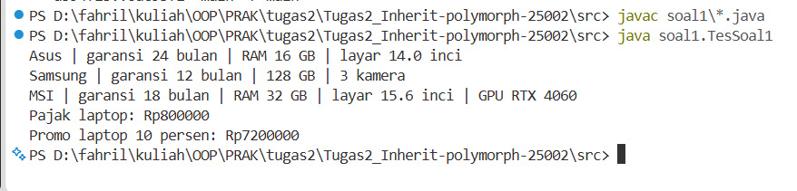
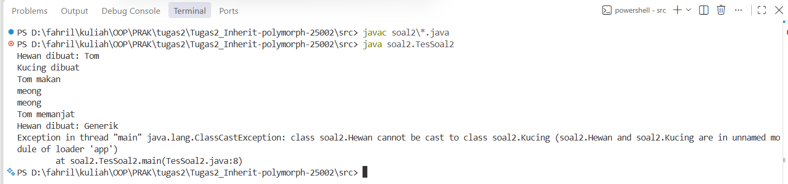
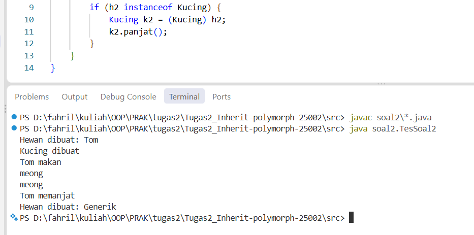
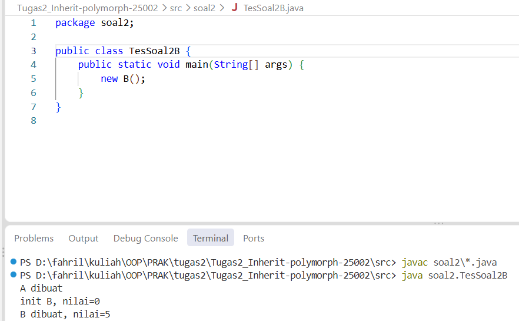
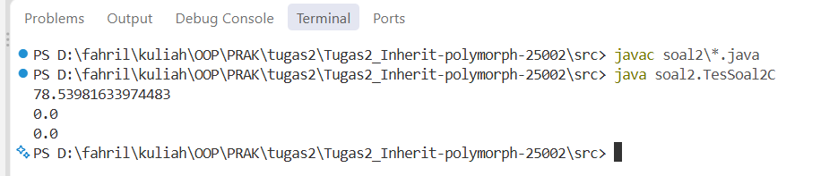
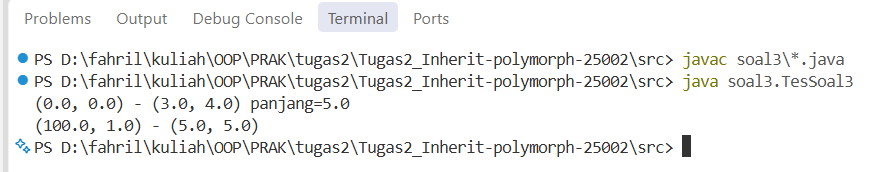
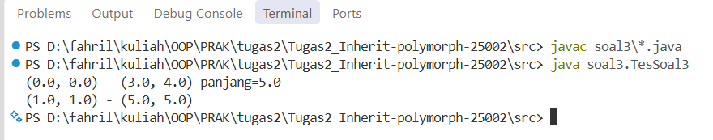
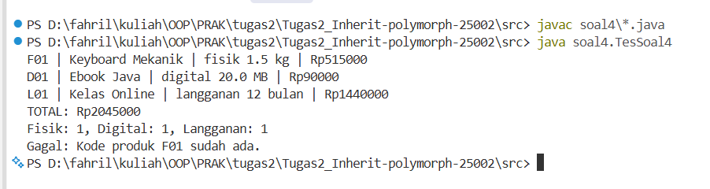
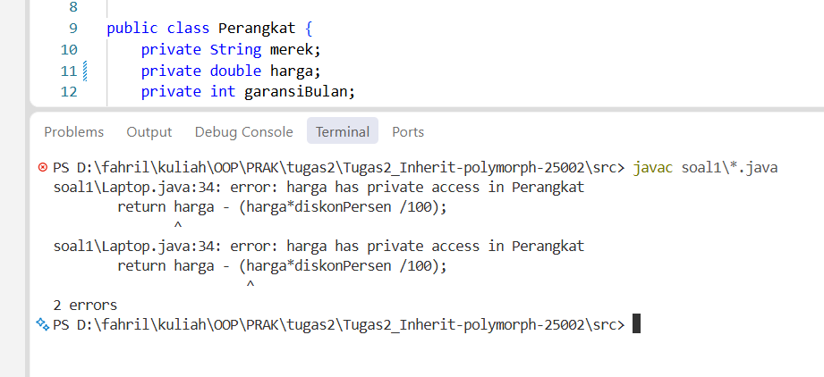
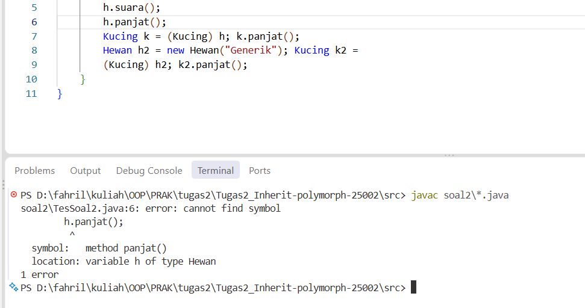

# Tugas 2 Praktikum Pemrograman Berorientasi Objek

**Materi:** Inheritance, Polymorphism, Composition, dan Defensive Copy  
**Nama:** Muhammad Fahril Khalifi  
**NPM:** 250810701100002  
**Kelas:** PBO A  
**Program Studi:** Informatika, Universitas Syiah Kuala

## Deskripsi

Project ini merupakan implementasi empat soal praktikum Java untuk mempelajari pewarisan (*inheritance*), method overriding, polymorphism, upcasting dan downcasting, constructor overloading, composition, serta defensive copy. Setiap soal berada dalam package terpisah dan dapat dijalankan melalui class penguji masing-masing.

## Fitur

| Soal | Implementasi | Konsep utama |
| --- | --- | --- |
| 1 | Hierarki perangkat elektronik: `Perangkat`, `Laptop`, `Ponsel`, `LaptopGaming`; pajak, promo, dan tambahan garansi | Inheritance, multilevel inheritance, `protected`, `super`, overriding |
| 2A | `Hewan` dan `Kucing`; pengujian upcasting, downcasting, serta `instanceof` | Polymorphism, dynamic dispatch, safe downcasting |
| 2B | `A` dan `B`; pemanggilan method override dari constructor | Urutan inisialisasi objek dan dynamic dispatch |
| 2C | `Lingkaran` dan `Titik`; overriding `luas()` dan `keliling()` | Polymorphism dan evaluasi hubungan *is-a* |
| 3 | `Titik` dan `Garis`; perhitungan jarak serta eksperimen aliasing | Composition, constructor overloading, defensive copy |
| 4 | Hierarki produk dan keranjang belanja; diskon, biaya berat, struk, dan penolakan kode duplikat | Polymorphism, overriding, `ArrayList`, `instanceof`, exception handling |

## Struktur Project

```text
Tugas2_Inherit-polymorph-25002/
├── src/
│   ├── soal1/
│   │   ├── Perangkat.java
│   │   ├── Laptop.java
│   │   ├── Ponsel.java
│   │   ├── LaptopGaming.java
│   │   └── TesSoal1.java
│   ├── soal2/
│   │   ├── Hewan.java
│   │   ├── Kucing.java
│   │   ├── TesSoal2.java
│   │   ├── A.java
│   │   ├── B.java
│   │   ├── TesSoal2B.java
│   │   ├── Lingkaran.java
│   │   ├── Titik.java
│   │   └── TesSoal2C.java
│   ├── soal3/
│   │   ├── Titik.java
│   │   ├── Garis.java
│   │   └── TesSoal3.java
│   └── soal4/
│       ├── Produk.java
│       ├── ProdukFisik.java
│       ├── ProdukDigital.java
│       ├── Langganan.java
│       ├── Keranjang.java
│       └── TesSoal4.java
├── screenshots/
├── .gitignore
└── README.md
```

## Cara Menjalankan

### Melalui Terminal (PowerShell)

Jalankan perintah berikut dari **folder Tugas2_Inherit-polymorph-25002**:

```powershell
cd src
javac soal1\*.java
java soal1.TesSoal1

javac soal2\*.java
java soal2.TesSoal2
java soal2.TesSoal2B
java soal2.TesSoal2C

javac soal3\*.java
java soal3.TesSoal3

javac soal4\*.java
java soal4.TesSoal4
```

> `TesSoal2` menggunakan versi final dengan `instanceof`, sehingga tidak lagi mengalami `ClassCastException`. Output exception sebelum perbaikan didokumentasikan terpisah.

## Hasil Pengujian

### Soal 1 — Hierarki Perangkat

```text
Asus | garansi 24 bulan | RAM 16 GB | layar 14.0 inci
Samsung | garansi 12 bulan | 128 GB | 3 kamera
MSI | garansi 18 bulan | RAM 32 GB | layar 15.6 inci | GPU RTX 4060
Pajak laptop: Rp800000
Promo laptop 10 persen: Rp7200000
```



### Soal 2A — Upcasting dan Downcasting

Output sebelum perbaikan:

```text
Hewan dibuat: Tom
Kucing dibuat
Tom makan
meong
meong
Tom memanjat
Hewan dibuat: Generik
Exception in thread "main" java.lang.ClassCastException: ...
```



Setelah menambahkan pemeriksaan `instanceof`, output berhenti secara normal setelah `Hewan dibuat: Generik`.



### Soal 2B — Constructor dan Overriding

```text
A dibuat
init B, nilai=0
B dibuat, nilai=5
```



### Soal 2C — Dynamic Dispatch

```text
78.53981633974483
0.0
0.0
```



### Soal 3 — Aliasing dan Defensive Copy

Sebelum defensive copy:

```text
(0.0, 0.0) - (3.0, 4.0) panjang=5.0
(100.0, 1.0) - (5.0, 5.0)
```



Sesudah defensive copy:

```text
(0.0, 0.0) - (3.0, 4.0) panjang=5.0
(1.0, 1.0) - (5.0, 5.0)
```



### Soal 4 — Keranjang Belanja

```text
F01 | Keyboard Mekanik | fisik 1.5 kg | Rp515000
D01 | Ebook Java | digital 20.0 MB | Rp90000
L01 | Kelas Online | langganan 12 bulan | Rp1440000
TOTAL: Rp2045000
Fisik: 1, Digital: 1, Langganan: 1
Gagal: Kode produk F01 sudah ada.
```



## Analisis Soal

### Soal 1 — `protected` dan `private`

Atribut `harga` pada class `Perangkat` awalnya menggunakan `protected`, sehingga subclass `Laptop` dapat mengaksesnya secara langsung pada method `hitungHargaPromo()`. Ketika aksesnya diubah menjadi `private`, kode `Laptop` yang mengakses `harga` secara langsung tidak dapat dikompilasi. Hal ini terjadi karena anggota `private` hanya dapat diakses langsung dari class yang mendeklarasikannya, bukan dari subclass. Setelah percobaan, akses atribut dikembalikan menjadi `protected` agar implementasi sesuai instruksi soal.

**Pesan error kompilasi yang diperoleh:**

```text
soal1\Laptop.java:34: error: harga has private access in Perangkat
return harga - (harga*diskonPersen /100);

soal1\Laptop.java:34: error: harga has private access in Perangkat
return harga - (harga*diskonPersen /100);

```



### Soal 2A — Polymorphism, Upcasting, dan Downcasting

**1. Prediksi output sebelum program dijalankan.** Constructor `Hewan` mencetak `Hewan dibuat: Tom`, lalu constructor `Kucing` mencetak `Kucing dibuat`. Pemanggilan `h.makan()` mencetak `Tom makan` dan `meong`, sedangkan `h.suara()` mencetak `meong` sekali lagi. Downcasting `h` ke `Kucing` berhasil, sehingga muncul `Tom memanjat`. Setelah `Hewan dibuat: Generik`, program mengalami `ClassCastException` saat mencoba mengubah objek `Hewan` menjadi `Kucing`.

**2. Mengapa `h.panjat()` gagal dikompilasi?** Variabel `h` memiliki tipe referensi `Hewan`, sedangkan method `panjat()` hanya didefinisikan pada class `Kucing`. Compiler menentukan method yang boleh dipanggil berdasarkan tipe referensi, sehingga `h.panjat()` tidak dikenali. Untuk memanggilnya, objek yang benar-benar bertipe `Kucing` harus di-*downcast* terlebih dahulu.



**3. Baris penyebab `ClassCastException`.** Kesalahan terjadi pada `Kucing k2 = (Kucing) h2;` karena `h2` merujuk ke objek yang dibuat menggunakan `new Hewan("Generik")`. Walaupun `Kucing` adalah turunan `Hewan`, tidak semua objek `Hewan` merupakan `Kucing`. Oleh karena itu, downcasting tersebut gagal saat runtime.

**4. Perbaikan menggunakan `instanceof`.** Pemeriksaan `if (h2 instanceof Kucing)` memastikan objek benar-benar merupakan `Kucing` sebelum downcasting dilakukan. Jika kondisi bernilai `false`, blok downcasting dilewati dan program tidak mengalami `ClassCastException`. Tipe variabel `h2` tetap `Hewan`, sesuai permintaan soal.

```java
if (h2 instanceof Kucing) {
    Kucing k2 = (Kucing) h2;
    k2.panjat();
}
```

**5. Mengapa `h.makan()` mencetak `meong`?** Method `makan()` didefinisikan pada `Hewan`, tetapi di dalamnya terdapat pemanggilan `suara()`. Objek yang dirujuk `h` sebenarnya merupakan instance `Kucing`, yang sudah meng-*override* `suara()`. Karena *dynamic dispatch*, Java menjalankan implementasi `Kucing.suara()`, sehingga suara yang muncul adalah `meong`.

### Soal 2B — Method Override dalam Constructor

Output program adalah `A dibuat`, `init B, nilai=0`, lalu `B dibuat, nilai=5`. Ketika `new B()` dijalankan, constructor `A` diproses lebih dahulu dan memanggil method `init()`. Karena method tersebut di-*override* oleh `B`, Java menjalankan `B.init()` saat atribut `nilai` belum diinisialisasi menjadi `5`, sehingga nilainya masih `0`. Pemanggilan method yang bisa di-*override* dari constructor berisiko karena method subclass dapat mengakses keadaan objek yang belum selesai diinisialisasi.

### Soal 2C — Dynamic Dispatch dan Hubungan *Is-A*

Pada `Lingkaran l2 = new Titik()`, tipe referensinya adalah `Lingkaran`, tetapi objek sebenarnya bertipe `Titik`. Ketika `l2.luas()` dipanggil, Java menggunakan implementasi `Titik.luas()` yang mengembalikan `0.0`, bukan `Lingkaran.luas()`. Perilaku tersebut menunjukkan *dynamic dispatch* pada method yang di-*override*. Namun, hubungan `Titik extends Lingkaran` kurang tepat secara desain karena titik bukan merupakan jenis lingkaran; titik lebih cocok menjadi komponen, misalnya sebagai pusat lingkaran.

### Soal 3 — Aliasing, Defensive Copy, dan Composition

**Prediksi output sebelum defensive copy.** Setelah `Garis g2 = new Garis(t, new Titik(5, 5))`, objek `g2` menyimpan referensi yang sama dengan variabel `t`. Ketika `t.setX(100)` dipanggil, koordinat objek tersebut berubah dan perubahan terlihat pada `g2`, sehingga output menjadi `(100.0, 1.0) - (5.0, 5.0)`. Perilaku ini disebut *aliasing*, yaitu dua referensi menunjuk objek yang sama.

**Perbaikan dengan defensive copy.** Constructor `Garis(Titik awal, Titik akhir)` diubah agar membuat objek `Titik` baru dari koordinat yang diterima. Dengan begitu, perubahan pada `t` setelah pembuatan `g2` tidak mengubah titik internal `g2`, dan output menjadi `(1.0, 1.0) - (5.0, 5.0)`. Defensive copy berguna ketika objek perlu mempertahankan keadaan internalnya secara mandiri.

```java
public Garis(Titik awal, Titik akhir) {
    this.awal = new Titik(awal.getX(), awal.getY());
    this.akhir = new Titik(akhir.getX(), akhir.getY());
}
```

**Kapan aliasing tepat?** Aliasing dapat berguna jika beberapa objek memang harus berbagi satu titik yang sama, misalnya dua garis yang perlu bergerak bersama saat titik penghubung diubah. Sebaliknya, defensive copy lebih tepat ketika perubahan pada objek sumber tidak boleh memengaruhi objek lain. Pilihan tersebut bergantung pada kebutuhan desain dan aturan perubahan data.

**Mengapa `Garis extends Titik` tidak tepat?** Inheritance menggambarkan hubungan *is-a*, sedangkan garis bukan merupakan jenis titik. Sebuah garis justru tersusun dari dua titik, yaitu titik awal dan titik akhir. Karena itu, composition dengan atribut `Titik awal` dan `Titik akhir` lebih sesuai daripada pewarisan.

### Soal 4 — Overriding, Overloading, dan Polymorphism

**Perbedaan overriding dan overloading.** *Overriding* terjadi ketika subclass mendefinisikan ulang method superclass dengan signature yang sesuai, misalnya `ProdukFisik.hitungHargaAkhir()` menggantikan implementasi `Produk.hitungHargaAkhir()`. Sementara itu, *overloading* terjadi ketika terdapat beberapa constructor atau method bernama sama dengan daftar parameter berbeda, misalnya `Garis(Titik, Titik)` dan `Garis(double, double, double, double)` pada Soal 3. Overriding memungkinkan perilaku berbeda berdasarkan tipe objek sebenarnya, sedangkan overloading menyediakan beberapa cara memanggil operasi dengan input berbeda.

**Kapan inheritance dan composition digunakan?** Inheritance digunakan ketika subclass benar-benar merupakan jenis dari superclass, seperti `ProdukFisik` yang merupakan jenis `Produk`. Composition digunakan ketika suatu objek memiliki atau tersusun dari objek lain, seperti `Garis` yang memiliki dua `Titik`. Pemilihan hubungan yang tepat membuat struktur program lebih mudah dipahami dan dikembangkan.

**Mengapa `cetakStruk()` tidak memerlukan `instanceof`, tetapi `hitungPerJenis()` memerlukannya?** `cetakStruk()` cukup memanggil `deskripsi()` dan `hitungHargaAkhir()` pada setiap objek bertipe `Produk` karena method tersebut sudah di-*override* oleh subclass. Java memilih implementasi yang sesuai melalui polymorphism tanpa perlu memeriksa jenis objek satu per satu. Sebaliknya, `hitungPerJenis()` memang perlu mengelompokkan objek berdasarkan jenis sebenarnya, sehingga menggunakan `instanceof`. Pengecekan `Langganan` harus dilakukan sebelum `ProdukDigital` karena `Langganan` merupakan subclass dari `ProdukDigital`.

**Risiko downcasting.** Downcasting yang tidak sesuai dengan tipe objek sebenarnya dapat menimbulkan `ClassCastException`, seperti yang ditunjukkan pada Soal 2A. Pemeriksaan `instanceof` sebelum casting membantu mencegah kesalahan tersebut. Dalam Soal 4, pengecekan jenis juga perlu dilakukan dengan urutan yang tepat agar produk langganan tidak terhitung sebagai produk digital biasa.

## Keterbatasan Program

- Data produk dan perangkat masih dibuat langsung dalam kode, belum melalui input pengguna atau penyimpanan database.
- Keranjang belum memiliki fitur menghapus produk atau mengubah jumlah pembelian.
- Perhitungan harga menggunakan nilai `double`, sehingga belum ditujukan untuk sistem transaksi finansial produksi yang memerlukan presisi desimal khusus.
- Defensive copy pada `Garis` diterapkan pada constructor; getter dan setter yang mengembalikan atau menerima referensi `Titik` masih dapat menyebabkan aliasing.
- Program berupa aplikasi console untuk demonstrasi konsep OOP, bukan aplikasi dengan antarmuka grafis.